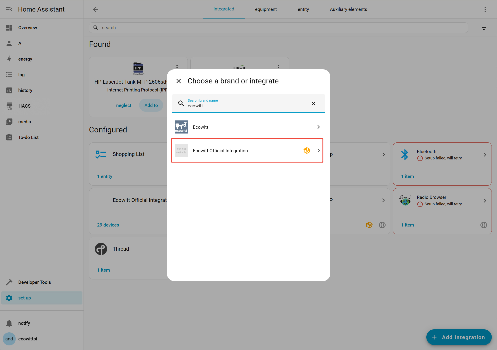
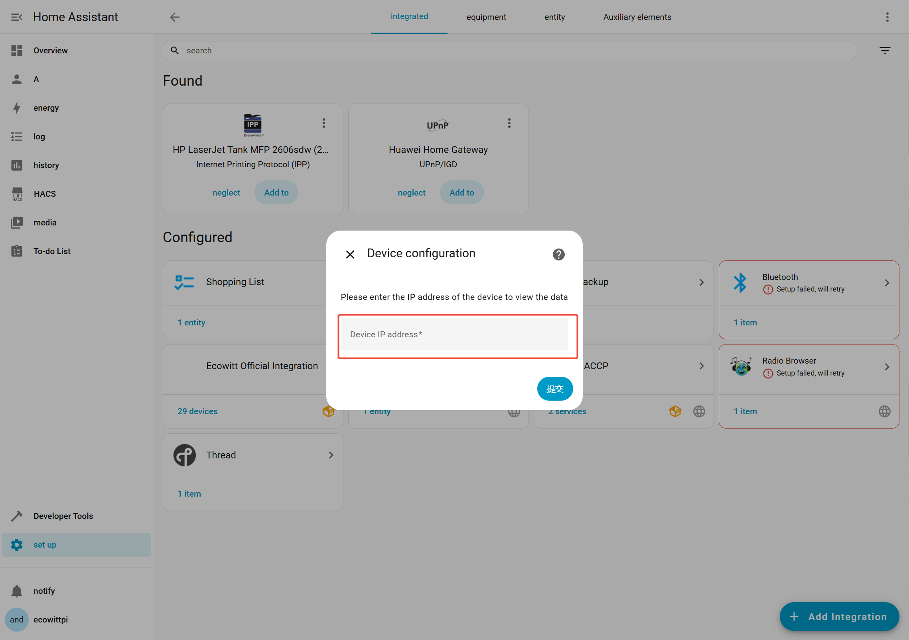
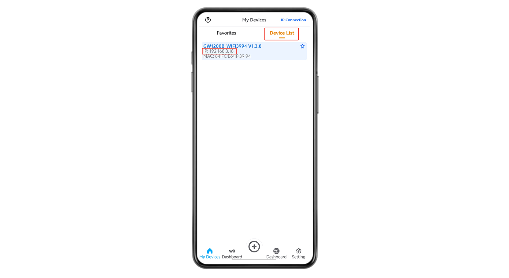
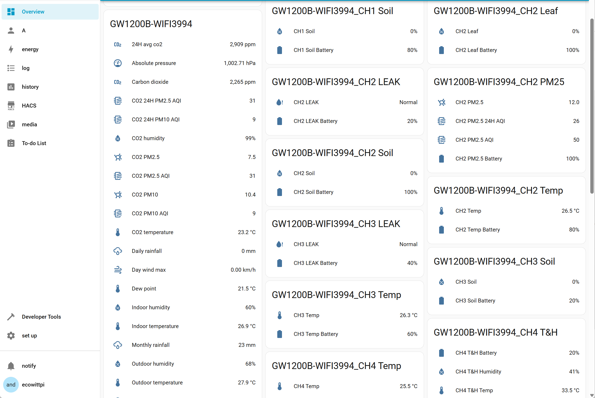

# Home Assistant - Ecowitt Official Integration
 

[](https://github.com/hacs/integration)

 
This integration uses the locally available http APIs to obtain data from the supported devices inside the local network.

## :computer: Installation

### HACS (Preferred)
This integration can be added to Home Assistant as a [custom HACS repository](https://hacs.xyz/docs/faq/custom_repositories):
1. From the HACS page, click the 3 dots at the top right corner.
1. Select `Custom repositories`.
1. Add the URL `https://github.com/Ecowitt/ha-ecowitt-iot`
1. Select the category `Integration`.
1. Click the ADD button.
1. Restart Home Assistant
1. Click the button below, or in the HA UI go to "Configuration" -> "Integrations" click "+" and search for "Ecowitt Official Integration"

[](https://my.home-assistant.io/redirect/hacs_repository/?owner=Ecowitt&repository=ha-ecowitt-iot&category=integration)

### Manual
1. Download the latest release from [here](https://github.com/Ecowitt/ha-ecowitt-iot/releases).
1. Create a folder called `custom_components` in the same directory as the Home Assistant `configuration.yaml`.
1. Extract the contents of the zip into folder called `ha_ecowitt_iot` inside `custom_components`.
1. Restart Home Assistant
1. Click the button below, or in the HA UI go to "Configuration" -> "Integrations" click "+" and search for "Ecowitt Official Integration"

[](https://my.home-assistant.io/redirect/hacs_repository/?owner=Ecowitt&repository=ha-ecowitt-iot&category=integration)

## :bulb: Usage
Ecowitt Official Integration:
This integration uses the locally available HTTP APIs to obtain data from the supported devices inside the local network.
Ecowitt Official Integration Compatibility Instructions:
| Ecowitt Official Integration        |  IoT device    |Gateway Model|
|:-----------:|:-----------:|:-----------|
| ×      | ×      |GW1000,WS6006,WN1900,WN1910,WS2320,WS2910,HP2550,HP3500,HP2560|
| ✓      | ×      |GW1100|
| ✓  | ✓  |GW1200,GW2000,GW3000,WS6210,WN1700,WN1820,WN1821,WN1920,WN1980,WS3800,WS3820,WS3900,WS3910|

HA Default Integration: www.home-assistant.io/integrations/ecowitt/ 
This integration uses the HTTP upload to a 3rd-party to obtain data from the supported devices.
HA Default Integration Compatibility Instructions:
| HA Default Integration   |  IoT device    |Gateway Model|
|:-----------:|:-----------:|:-----------|
| ×      | ×      |WS6006|
| ✓      | ×      |GW1000,WN1900,WN1910,WS2320,WS2910,HP2550,HP3500,HP2560,GW1100,GW1200,GW2000,GW3000,WS6210,WN1700,WN1820,WN1821,WN1920,WN1980,WS3800,WS3820,WS3900,WS3910|


To set up Ecowitt Official Integration, follow these steps:
1. Configure your gateway device on your LAN using the WSView Plus app or Ecowitt app on your phone.
2. Obtain the device's IP address through the web UI or WSView Plus app.
3. Enter the device's IP address in the integration. Upon successful connection, the integration will retrieve data from the gateway device.







## Compatibility Instructions for all ecowitt network consoles


## Restarting an unresponsive gateway

A gateway can keep receiving sensors and uploading weather data while its HTTP
server stops responding. In that situation both the web UI and this integration's
HTTP polling fail, but the separate TCP API may still work.

Once the integration has recorded the gateway's full MAC address, its device page
provides a **Restart gateway** button. This button remains available during HTTP
outages. It restarts the gateway, not Home Assistant.

If the integration cannot finish loading because HTTP is already unavailable,
use **Developer tools → Actions → Ecowitt Official Integration: Restart gateway**
and select the existing integration instance. This action requires administrator
access when called by a user. For an automation or script:

```yaml
action: ha_ecowitt_iot.restart_gateway
data:
  config_entry_id: YOUR_ECOWITT_CONFIG_ENTRY_ID
```

To enable unattended recovery, go to the integration's **Configure** options and
enable **Automatically restart an unresponsive gateway**. This is disabled by
default. It attempts a restart after three consecutive failed HTTP polls,
including failed setup retries. Successful polls reset the counter. Changing
recovery settings with the existing IP address does not require HTTP access.

Every restart first reads and checks the full MAC address through TCP port
**45000**. A missing identity, MAC mismatch, unreachable TCP API, or invalid API
response prevents a restart. All restart paths share a **30-minute cooldown**,
persisted across integration reloads and Home Assistant restarts. The cooldown is
recorded before sending the command, so a lost reply cannot cause a reboot loop.
HTTP polling is retried after the gateway has had ten seconds to boot; sensor
availability returns only after a successful HTTP poll.

This recovery path was verified with a GW3010 identifying itself as
`GW3000B_V1.2.4`. Other devices must implement the same
[Ecowitt TCP API MAC and reboot commands](https://oss.ecowitt.net/uploads/20260112/TCP%20API%20Interface%20Communication%20Protocol%20V1.7.0.pdf).
It cannot recover a powered-off gateway or one whose TCP API is also unresponsive.
A restart briefly interrupts sensor reception and uploads, and may reset volatile
weather counters maintained by the gateway. No firmware update or factory reset
is performed.

### Development checks

Use Python 3.14 in a virtual environment:

```sh
python -m pip install -r requirements_test.txt
python -m pytest -q
```

## Stargazers over time
[](https://starchart.cc/Ecowitt/ha-ecowitt-iot)
